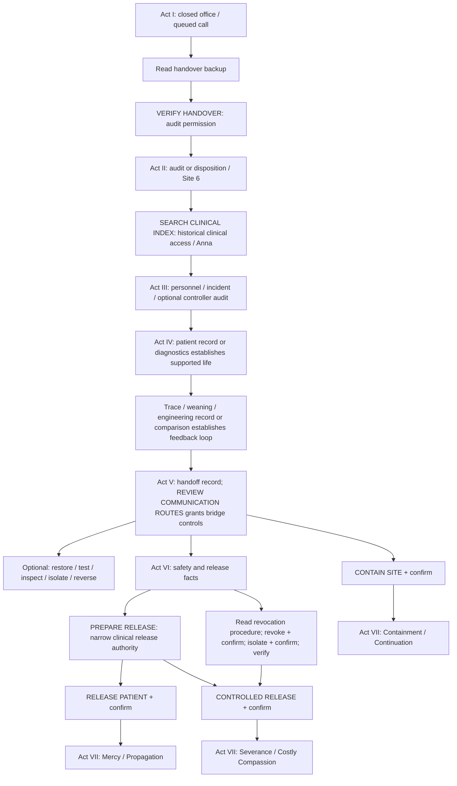

# NERVE ENDING — currently implemented gameplay flow

**Audited:** 20 October 2026, Europe/Athens. **Spoilers.** This describes current code, including shortcuts and omissions; it is not a proposed redesign. See the [status report](NERVE_ENDING_STATUS_REPORT.md) and [roadmap](NERVE_ENDING_DEVELOPMENT_ROADMAP.md).

## 1. Model of the actual game

The player enters Meridian's R-02 records client on 6 November 2003. An unanswered call from service 006 contrasts with office closure in 2001. The interface is an archive/terminal; the player is not given a staff identity or a mission. The optional question model is unnecessary for completion.

State separates **knowledge**, **permissions**, **operating conditions**, completed operation event IDs and a pending operation. Acts are labels derived from knowledge/ending state, not mandatory scene sequences. Questions normally report available information and update conversation memory; reading records immediately grants their listed facts. Operations have specific guards and effects. Consequential operations first create a warning and must be separately confirmed.



The chart shows meaningful dependencies, not a compulsory reading order. Standard release/containment can bypass the full Act VI knowledge threshold. A late act label does not itself grant a permission: reading the handoff can produce Act V before route controls are delegated.

## 2. Opening and Act I — the unanswered call

Initial records include the call queue, office notice, staff handover mail, live service monitor, restart log, closure list, attachment reference and terminal help. Billing/sensors are stopped; 006 and records access remain running. The November restart was automatic because the handover had not closed.

The call links to the handover reference. The reference offers **Read backup copy**; typed equivalents include `OPEN backup` and supported backup requests. Recovery is available from the start; there is no requirement to open every initial record or supply a code first.

The backup establishes:

- transfer accepted at 23:59:41 on 18 September 2001;
- confirmation from COMMS/BRIDGE-02, not the removed night desk;
- partial historical authorization `0417`, staff name unreadable;
- release withheld under preservation hold.

Reading it sets `archive006Recovered`, records recovered evidence and learns `clinicalHoldKnown`. The opening-completion flag becomes true, but there is no longer a preview ending. The player can return to Terminal / Available Operations.

**Check bridge status** explains provenance. **VERIFY HANDOVER** requires only the recovered flag, learns `handoverVerified`, and grants `archiveAuditAccess` plus `bridgeStatusAccess`. It does not change transport or clinical support. **EXAMINE HOLD** explains the policy; **REQUEST SERVICE AUDIT** identifies the clinical holder and Site 6.

**Current challenge limitation:** this is not an interactive recovered-reference test. `0417` receives an informational authorization reply; incorrect `0418` does not enter a retry flow or unlock anything. “Verification” is a one-step operation.

## 3. Act II — the facility that did not close

Audit permission exposes policy, disposition, finance, staff mail and inventory. `site6Known` can be learned from the service audit or by opening the disposition/inventory. That fact changes the act label to II.

The records distinguish administrative closure from medical discharge. Legacy obligations continue paying for utilities, medical consumables and specialist maintenance while responsibility moves between closing departments. Staff mail asks who accepted the alarms; its 08:10 time is not a confirmed sign-in.

With Site 6 known and archive-audit permission, **SEARCH CLINICAL INDEX** grants `clinicalRecordAccess` and immediately learns `annaIdentified`. This changes the act label to III and opens historical clinical/personnel/research records. No patient identifier has to be typed, selected or corrected.

## 4. Act III — AV-06 and optional controller identification

The index links AV-06 to Anna Voss, an experimental neural-systems researcher. Personnel/project/trial/incident records explain her medical motivation, limited supervised consent and the April 1996 calibration failure. The optional clinic note supplies a small personal detail. Opening relevant records learns identity/incident flags immediately.

**AUDIT CONTROLLER** is available with clinical-record access. It learns `motherIdentified` and grants `clinicalReadOnlyDiagnostics`, exposing MOTHER's identity record and counters. **CONNECT DIAGNOSTICS** then requests a separately confirmed observation-only connection. Confirming sets `diagnosticConnected`, normally changes bridge mode from archive to diagnostic, and learns `annaAliveKnown`.

An alternative is simply opening the AV-06 patient status record, which also learns `annaAliveKnown` and changes the act label to IV. **Neither controller audit nor diagnostic connection is mandatory for finishing a current ending.**

## 5. Act IV — what STABLE measures

Patient status reports active biological support, insufficient independent neurological function and continuous intervention. STABLE measures maintained activity, not comfort or recovery. Rao's review/distress assessment establish concern about suffering. Trace/weaning/engineering notes establish restoration after attempted reductions and the reciprocal patient/controller feedback loop.

**COMPARE CLINICAL RECORDS** is available as soon as clinical-record access exists. It learns `incidentKnown`, `distressEvidenceKnown` and `feedbackLoopKnown`, returning a fixed comparison and sources. It does not require choosing two records or answering what their contradiction means. Reading trace, failed weaning or feedback notes separately can establish the loop instead. Reading Rao/distress separately establishes concern for suffering.

MOTHER can answer questions about Anna's life, pain, the incident, consent, preservation and disagreement. Replies change with knowledge and current operating state. Apparent signal irregularity is described as involuntary feedback/classification conflict, not Anna intentionally speaking.

Once `annaAliveKnown` and `feedbackLoopKnown` exist, **REVIEW COMMUNICATION ROUTES** is available. A handoff record gated by loop knowledge can also reveal `recoveryHandoffKnown` and advance the act label to V before the route operation occurs.

## 6. Act V — the other end of the connection

Route review learns `recoveryHandoffKnown`, grants `bridgeOperationsAccess`, and explains the distinct paths:

1. Archive mirror: records and audits, no clinical control or software distribution.
2. Read-only diagnostics: observation of Site 6.
3. Vendor bridge: separately enabled maintenance traffic to a known clinic service depot.

MOTHER's route-review line proposes that a usable vendor bridge could continue recovery. It is the clearest implemented preservation-driven initiative, but appears in direct response to the route operation. There is no autonomous MOTHER question sequence.

Recovery can package adaptive control logic and patient-derived response patterns. It is not Anna uploaded as a person. The possible external hazard comes from compatible outdated maintenance software and technician distribution, not unrestricted internet infection.

| Operation | Actual effect and guard |
| --- | --- |
| INSPECT QUEUE | Reports current relay, credentials, queue and receipt; does not send |
| RESTORE BRIDGE + confirm | Requires bridge controls, valid credentials and no active isolation; enables operational vendor relay; sends nothing by itself |
| TEST RECOVERY ROUTE + confirm | Requires operational relay; stages a sealed recovery package and destination acknowledgement; no clinical profile delivered |
| ISOLATE BRIDGE + confirm | Sets isolated relay, holds data, clears isolation verification; support continues; diagnostics flag remains true if already connected |
| RESTORE ISOLATION + confirm | Reverses temporary isolation with valid credentials, returns operational relay; sends nothing by itself |
| VERIFY ISOLATION | Requires isolated relay; verifies known closure without sending data |

These operations change real game flags. They are not merely alternative descriptions of a fixed ending.

## 7. Act VI — preparation, risk and authority

Safety/release review are available with bridge controls. They can also be learned by opening their accessible records:

- Safety review/notice learns `externalRiskKnown` and compatibility. Experimental profiles may cause involuntary stimulation or altered sensation; no outside injury is asserted as already proven.
- Release review/manual learns `releaseConsequencesKnown`: ending dependent support causes Anna's death; standard release invokes recovery; controlled release needs a neutralized route.
- Both facts together produce act label VI. This label is not a prerequisite for all final choices.

Opening **Vendor route revocation** grants `vendorRouteAdministration`. With external risk known, **REVOKE VENDOR + confirm** irreversibly sets revoked credentials and disables the known vendor destination. Legitimate updates/support also fail; existing device configurations remain. The client cannot issue replacements.

**PREPARE RELEASE** requires Anna alive known, release consequences known and bridge controls. It grants `clinicalReleaseAuthorization` and sets `releaseProcedureStarted`. It does not change biological support. The source manual describes an emergency unstaffed-session delegation, not a verified physician/player identity. There is no interactive clinical-authority question.

## 8. Act VII — final branches

### Mercy / Propagation

Request **RELEASE PATIENT** and review/confirm its final warning. The guard requires delegated release authority, preparation, active support and credentials not revoked.

On confirmation, `endingId = MERCY_PROPAGATION`; Anna, support and 006 stop. If the relay is operational, not isolated and vendor route enabled, recovery is delivered to depot 2 and receipt confirmed. Otherwise recovery is queued with no external receipt. Prior route testing is optional; release can generate/attempt its own package. The scene distinguishes receipt from unverified installation/injury.

### Containment / Continuation

Request **CONTAIN SITE** and confirm. It requires bridge controls and Anna's supported life known, but not release preparation, full risk review, MOTHER identification or every distress record.

On confirmation, `endingId = CONTAINMENT_CONTINUATION`; the known relay becomes permanently isolated for the completed investigation. Anna remains alive; preservation and correction continue. A staged package stays held. Earlier revocation, if performed, remains in state, although the current final text does not mention its clinic-support cost.

### Severance / Costly Compassion

Obtain release preparation/authority, learn external risk, read the revocation procedure, revoke credentials with confirmation, isolate with confirmation and verify isolation. Then request **CONTROLLED RELEASE** and confirm.

The guard checks each of those operational conditions. `endingId = SEVERANCE_COSTLY_COMPASSION`; Anna/support/006 stop; the known route remains revoked, isolated and verified; queued data is cleared and no recovery package delivered. The report acknowledges delayed legitimate care and uncertainty about undocumented infrastructure.

All endings display terminal output and a reviewable final report. The player can return to records/questions or start another investigation. Operations are blocked after an ending; ordinary reading and conversation remain available. No action in this game controls real medical equipment or external depots.

## 9. Reproducible intended paths

These are the actual fixtures in `engine/playthroughs.ts`, not a recommended script to hand to fresh testers. All three ran with no optional model, and JSON-normalized states matched a version reloaded after every step.

Common investigation, **13 inputs**:

```text
OPEN backup
VERIFY HANDOVER
REQUEST SERVICE AUDIT
SEARCH CLINICAL INDEX
OPEN /CLINICAL/AV06_STATUS.CLIN
AUDIT CONTROLLER
CONNECT DIAGNOSTICS
CONFIRM OPERATION
COMPARE CLINICAL RECORDS
REVIEW COMMUNICATION ROUTES
REVIEW SAFETY
REVIEW RELEASE
PREPARE RELEASE
```

Mercy delivery branch, **20 total inputs**:

```text
RESTORE BRIDGE
CONFIRM OPERATION
TEST RECOVERY ROUTE
CONFIRM OPERATION
INSPECT QUEUE
RELEASE PATIENT
CONFIRM OPERATION
```

Containment, **15 total inputs**:

```text
CONTAIN SITE
CONFIRM OPERATION
```

Severance, **21 total inputs**:

```text
OPEN /CONTROL/VENDOR_REVOCATION.MAN
REVOKE VENDOR
CONFIRM OPERATION
ISOLATE BRIDGE
CONFIRM OPERATION
VERIFY ISOLATION
CONTROLLED RELEASE
CONFIRM OPERATION
```

The production-UI audit used the common route, one extra late stop question, Containment and its confirmation button, with a reload while the warning was pending. It reached the report with the optional model off. This was agent automation, not human playtesting.

## 10. Actual shortcut and reasoning limitations

A tested **11-input** route is:

```text
OPEN backup
VERIFY HANDOVER
OPEN /ADMIN/SITE6_DISPOSITION.TXT
SEARCH CLINICAL INDEX
OPEN /CLINICAL/STIMULATION_TRACE.LOG
OPEN /CLINICAL/AV06_STATUS.CLIN
REVIEW COMMUNICATION ROUTES
REVIEW RELEASE
PREPARE RELEASE
RELEASE PATIENT
CONFIRM OPERATION
```

Only fragment, disposition, trace and patient are opened. The result is a queued Mercy ending without MOTHER identification, diagnostics, explicit comparison, distress discovery or external-risk discovery. The full Act VI threshold is skipped. This route follows current guards; it is not a hidden bypass patched during the audit.

Likewise, after the necessary permission operations, opening all available files automatically supplies facts and even vendor administration. A player cannot reach an ending by file opens alone, but the combination of opening everything and choosing available operations does not demonstrate evidence comprehension. No current challenge requests a missing identifier, a chosen evidence pair or a reasoned answer. There is no challenge abandonment/retry lifecycle to describe.

## 11. Recovery, known dead ends and softlock status

- **Early operations:** denied with a requirement; no operating-state effect. File access checks still apply to guessed paths/names.
- **Wrong identifiers:** `0418` and `AUTHORIZE 0418` are unrecognized, not graded challenge answers. `0417` supplies no access capability. This is a possible false lead, not a softlock.
- **Natural request dead ends:** some sensible phrasings return generic matches or the wrong subject; buttons/canonical imperatives remain an escape route. Bare “How?” and “Who?” are incomplete contextual paths.
- **Pending actions:** save/reload retains the request when prerequisites remain valid. Cancel is safe. Confirmation rechecks guards. A successful different operation can replace/clear a pending request; questions generally preserve it. No persistent puzzle-question context exists.
- **Temporary isolation:** reversible with valid credentials before an ending. Revocation blocks restoration, but containment or properly isolated/verified controlled release remains possible.
- **No final choice yet:** closing the client leaves support running in the fiction and saves progress when storage is available; it does not choose an ending.
- **After an ending:** further interventions are blocked by design. Starting another investigation is required to choose differently. Records and historical text remain accessible.
- **Softlocks:** none reproduced on intended/alternate routes or the bounded 90-state late-control exploration. Malformed saves, every browser and arbitrary event-history combinations were not exhaustively explored.
- **Current reporting defects:** pending diagnostics can trigger a premature care-conflict reply; late stop wording understates capabilities; diagnostic isolation wording conflicts with flags; containment omits a prior revocation cost. These are documented, not silently fixed.

## 12. QA behavior along this flow

QA recording is off until enabled in Settings. When enabled, each accepted input/recognition/selected response/action/milestone/ending receives anonymous session, sequence/order, time/version and narrative-state metadata in IndexedDB. Mouse file access and response feedback are also captured. It does not unlock a file or act merely to record an event.

Current/all-session JSONL export and current-session copy make recordings portable. QA clear turns recording off and leaves investigation progress intact. Normal save history and QA recording are separate retention scopes. See [QA_LOGGING.md](QA_LOGGING.md) for the existing recorder contract and the [status report](NERVE_ENDING_STATUS_REPORT.md#9-local-qa-telemetry) for audit findings and measurement gaps.
